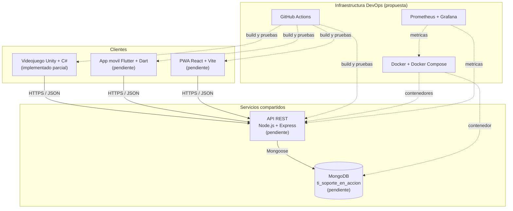
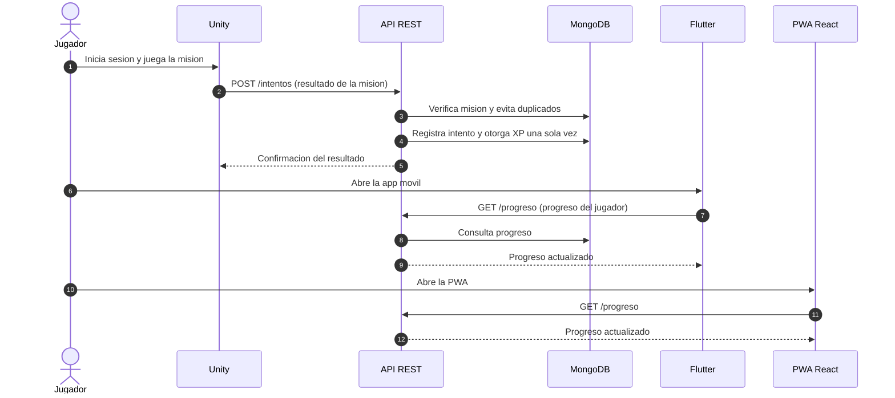

# Diagrama de arquitectura — Unity + Flutter + API REST

Este documento presenta la arquitectura del sistema **TI: Soporte en Acción**. Los tres clientes (Unity, Flutter y React) acceden a los datos exclusivamente a través de la API REST; ninguno se conecta directamente a MongoDB (RNF-14).

> Los componentes marcados como *(propuesto)* o *(pendiente)* aún no están implementados en el repositorio.

## 1. Arquitectura general

## 2. Interacción por casos de uso principales

## 3. Responsabilidad de cada componente

| Componente | Responsabilidad | Estado |
| --- | --- | --- |
| Unity + C# | Escenas, diálogos y retos; envía resultados a la API | Implementado parcial |
| Flutter + Dart | Consulta de misiones, guías y progreso vía API | Pendiente |
| React + PWA | Progreso, guías y panel de administración | Pendiente |
| API REST | Autenticación, autorización y datos comunes | Pendiente |
| MongoDB | Persistencia de cuentas, misiones, intentos y progreso | Pendiente |

## Notas

- La comunicación cliente–servidor será por **HTTPS** (RNF-02).
- La autorización se valida en el servidor por rol y propiedad del recurso (RNF-03).
- El diagrama de monitoreo se detalla en [`monitoreo.md`](monitoreo.md).
- El pipeline CI/CD y los ambientes se detallan en [`pipeline_cicd.md`](pipeline_cicd.md).
