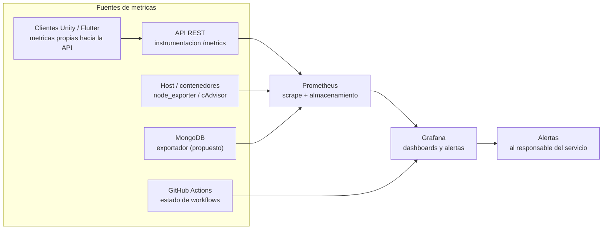
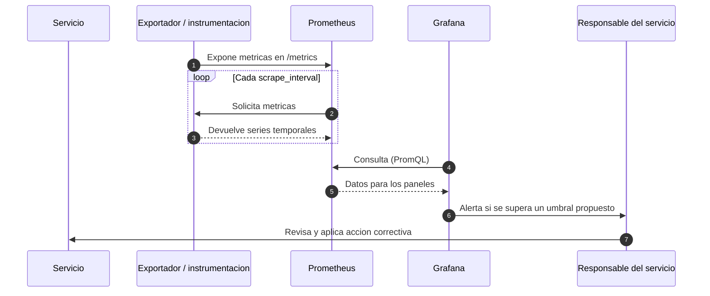

# Diagrama — Monitoreo con Prometheus y Grafana

Este documento presenta la arquitectura de monitoreo propuesta para **TI: Soporte en Acción**.

> **Estado.** Prometheus y Grafana **no están implementados**. El siguiente diagrama es una **propuesta**. No existen datos ni umbrales calibrados.

## 1. Arquitectura de monitoreo

## 2. Flujo de recolección y alerta

## 3. Dashboards propuestos

| Dashboard | Panel | Métrica base | Estado |
| --- | --- | --- | --- |
| API — Rendimiento | Latencia p95 | `http_request_duration_seconds` | Propuesta |
| API — Salud | Disponibilidad y errores 5xx | `up`, `http_requests_total` | Propuesta |
| Infraestructura | CPU, RAM, disco | `node_*` | Propuesta |
| Base de datos | Conexiones | Métricas del driver | Propuesta |
| CI/CD | Estado de workflows | API de GitHub Actions | Propuesta |

## 4. Alertas propuestas

| Alerta | Condición propuesta | Prioridad |
| --- | --- | --- |
| API no disponible | `up == 0` durante 1 min | P1 |
| Latencia alta | p95 > 2000 ms durante 5 min | P2 |
| Errores 5xx altos | tasa > 1 % durante 5 min | P2 |
| Disco casi lleno | uso > 85 % | P3 |

## Notas

- Prometheus no recoge métricas de aplicaciones de escritorio o móviles de forma nativa; Unity y Flutter requieren **instrumentación propia** que las envíe a la API.
- El detalle de métricas y umbrales está en el [Documento 4](../04_Metricas_Monitoreo.md).
- La arquitectura general está en [`arquitectura.md`](arquitectura.md).
