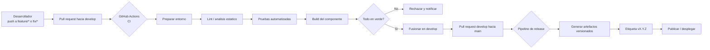
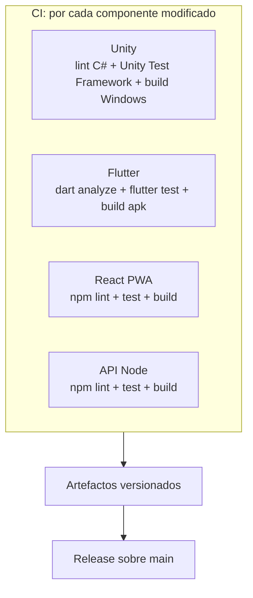
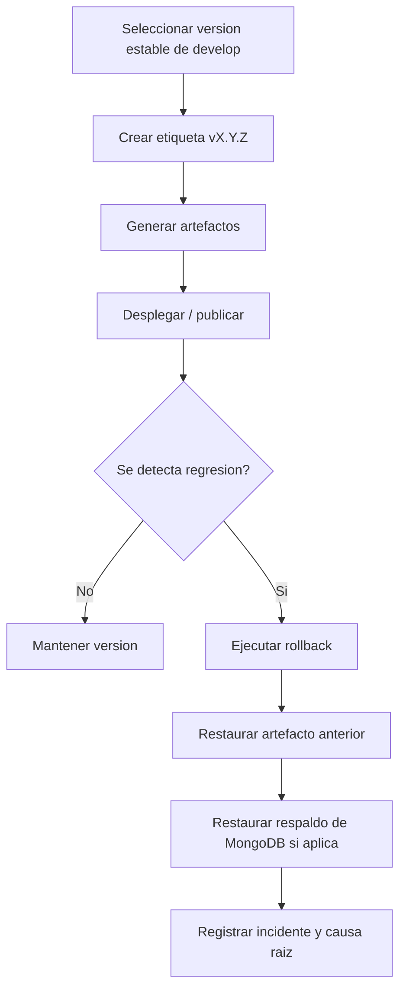

# Diagramas — Pipeline CI/CD, ambientes y flujo de liberación

Este documento presenta los diagramas del pipeline de integración y entrega continuas, los ambientes (desarrollo, pruebas y producción) y el flujo de liberación con reversión.

> **Estado.** Toda la infraestructura de este documento es **propuesta pendiente de implementación**. No existe `.github/workflows/` ni Docker en el repositorio.

## 1. Pipeline CI/CD

## 2. Matriz de componentes del pipeline (propuesta)

## 3. Ambientes de desarrollo, pruebas y producción

```mermaid
flowchart LR
    subgraph DEV["Desarrollo (local)"]
        D1["Unity 6000.6.3f1"]
        D2["Flutter / Node / React"]
        D3["MongoDB local 27017"]
    end
    subgraph TEST["Pruebas (CI, efimero)"]
        T1["GitHub Actions runner"]
        T2["MongoDB de prueba"]
        T3["Datos de ejemplo (seeds)"]
    end
    subgraph PROD["Produccion (propuesta, no desplegada)"]
        P1["API en contenedor"]
        P2["MongoDB gestionado"]
        P3["PWA por HTTPS"]
    end
    DEV -->|"pull request"| TEST
    TEST -->|"merge a main"| PROD
```

## 4. Flujo de liberación y rollback

## Notas

- Los filtros `paths` permiten ejecutar solo el pipeline del componente afectado.
- Los secretos se gestionan con *GitHub Secrets*; nunca en el YAML.
- El *rollback* por componente se describe en el [Documento 1](../01_Justificacion_Liberacion_Despliegue.md) y los ambientes en el [Documento 2](../02_Entornos_Requerimientos.md).
- La arquitectura general está en [`arquitectura.md`](arquitectura.md).
