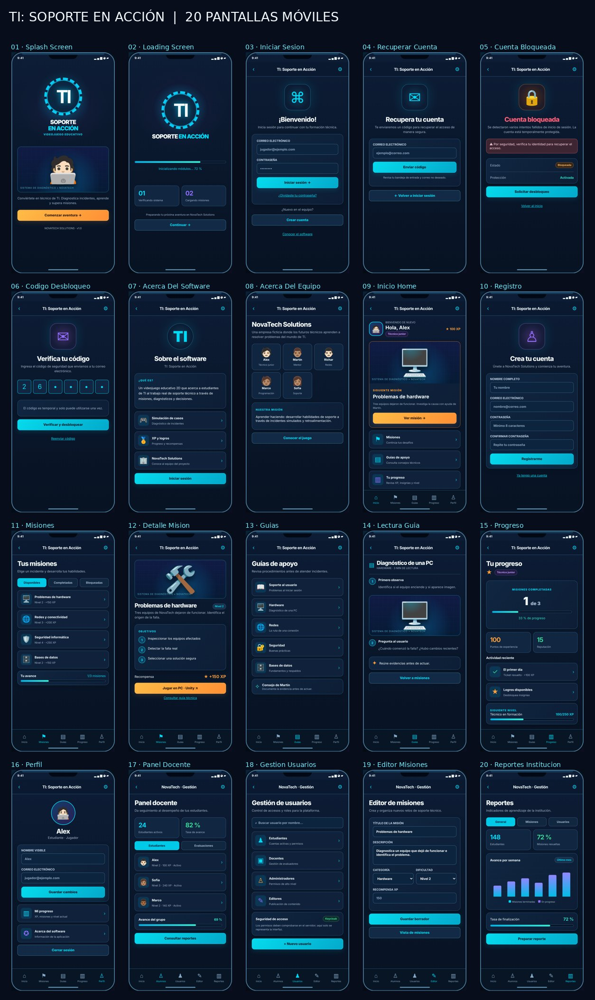

# TI: Soporte en Acción · Práctica de Navegación (Flutter móvil)

**Proyecto Integrador:** TI: Soporte en Acción  
**Empresa ficticia:** NovaTech Solutions  
**Plataforma única de diseño:** aplicación móvil multiplataforma **Flutter** (Android/iOS).  
**Función adicional:** botón `🎨 Normal / ✏️ Lápiz` en el diagrama de navegación y en el visor interactivo, con cambio de imagen y tema sin perder la pantalla seleccionada.

**Entregables:** 20 sketches a lápiz + **20 diseños visuales a color** (ambos en PNG individuales), diagramas, prototipo interactivo, guía de diseño Flutter y documentación de los **15 apartados** de la práctica.



Se conserva también el [resumen original de bocetos a lápiz](recursos/vista_general_20_sketches.jpg).

## Abrir los entregables

- [**Galería general (20 diseños a color + sus 20 sketches)**](index.html)
- [**Prototipo visual móvil a color**](mockups-color/index.html)
- [Galería de los 20 sketches a lápiz originales](galeria_sketches_lapiz.html)
- [**Identidad visual, paleta y reglas de diseño Flutter**](docs/10_identidad_visual_flutter.md)
- [Tema Material 3 de Flutter (Dart de referencia)](flutter_referencia/lib/theme/app_theme.dart)
- [**Diagrama interactivo con cambio de modo Normal/Lápiz**](prototipo/index.html)
- [Diagrama estático de navegación](diagramas/navegacion_estatica.svg)
- [Diagrama editable Mermaid](diagramas/navegacion_general.mmd)
- [Guía con las 15 actividades y sus evidencias](docs/README_15_ACTIVIDADES.md)
- [Fichas individuales de cada sketch](docs/04_fichas_20_sketches.md)
- [Análisis de requisitos](docs/01_analisis_requerimientos.md)
- [Roles y permisos](docs/02_roles_y_permisos.md)
- [Rutas y reglas de navegación](docs/03_arquitectura_navegacion.md)
- [Matriz de transiciones](docs/05_matriz_transiciones.md)
- [Plan de 26 pruebas y evidencias](docs/06_plan_validacion.md)
- [Verificación local del paquete (40 comprobaciones)](docs/reporte_verificacion_local.md)
- [Proceso y decisiones](docs/07_proceso_decisiones.md)
- [Prompt listo para Archify](docs/08_prompt_archify.md)
- [Entrega en GitHub](docs/09_guia_github_entrega.md)

## Inventario (20 sketches PNG)

| ID | Pantalla | Rol autorizado | PNG |
|---|---|---|---|
| P01 | Splash Screen | Público | [Ver](sketches/P01_Splash_Screen.png) |
| P02 | Loading Screen | Público | [Ver](sketches/P02_Loading_Screen.png) |
| P03 | Iniciar sesión | Público | [Ver](sketches/P03_Iniciar_Sesion.png) |
| P04 | Recuperar cuenta | Público | [Ver](sketches/P04_Recuperar_Cuenta.png) |
| P05 | Cuenta bloqueada | Público | [Ver](sketches/P05_Cuenta_Bloqueada.png) |
| P06 | Código de desbloqueo | Público | [Ver](sketches/P06_Codigo_Desbloqueo.png) |
| P07 | Acerca del software | Público | [Ver](sketches/P07_Acerca_Del_Software.png) |
| P08 | Acerca del equipo / empresa | Público | [Ver](sketches/P08_Acerca_Del_Equipo.png) |
| P09 | Inicio (Home) | Autenticado | [Ver](sketches/P09_Inicio_Home.png) |
| P10 | Registro de cuenta | Público | [Ver](sketches/P10_Registro.png) |
| P11 | Misiones | Estudiante/Jugador | [Ver](sketches/P11_Misiones.png) |
| P12 | Detalle de misión | Estudiante/Jugador | [Ver](sketches/P12_Detalle_Mision.png) |
| P13 | Guías de apoyo | Estudiante/Jugador | [Ver](sketches/P13_Guias.png) |
| P14 | Lectura de guía | Estudiante/Jugador | [Ver](sketches/P14_Lectura_Guia.png) |
| P15 | Mi progreso | Estudiante/Jugador | [Ver](sketches/P15_Progreso.png) |
| P16 | Mi perfil | Autenticado | [Ver](sketches/P16_Perfil.png) |
| P17 | Panel docente | Docente/Evaluador | [Ver](sketches/P17_Panel_Docente.png) |
| P18 | Gestión de usuarios | Administrador | [Ver](sketches/P18_Gestion_Usuarios.png) |
| P19 | Editor de misiones | Editor de contenido | [Ver](sketches/P19_Editor_Misiones.png) |
| P20 | Reportes institucionales | Institución educativa | [Ver](sketches/P20_Reportes_Institucion.png) |

**Conteo:** 9 pantallas generales obligatorias (P01–P09) + 11 adicionales (P10–P20). Se conservaron los veinte PNG individuales.

## Organización

```text
practica07-navegacion-flutter/
├── README.md
├── index.html                      # galería local
├── sketches/                       # 20 PNG de baja fidelidad a lápiz
├── mockups-color/                  # 20 PNG a color, HTML, CSS y JS de demostración
├── galeria_sketches_lapiz.html     # galería original
├── prototipo/
│   ├── index.html                  # diagrama interactivo local
│   └── datos_navegacion.js         # 20 pantallas + 51 transiciones
├── diagramas/
│   ├── navegacion_estatica.svg
│   └── navegacion_general.mmd
├── recursos/
│   └── vista_general_20_sketches.jpg
├── docs/                           # documentación de las 15 actividades
├── evidencias/                     # plantilla: adjuntar capturas reales
└── scripts/verificar_entrega.py
```

## Consultar el prototipo

Descomprime el ZIP, conserva la estructura de carpetas y abre `prototipo/index.html` con Chrome, Edge o Firefox. Es local: no hace llamadas a internet. Selecciona un rol, usa los botones de escenario y pulsa nodos para ver el sketch asociado. La galería `index.html` permite descargar cada PNG por separado.

## Restricciones y estado real

La parte visual y documental está preparada. La **ejecución en Archify**, la **validación con servicios reales** y el **push/pull request a GitHub** siguen pendientes: deben realizarse y dejar evidencias. El HTML no constituye autenticación ni autorización de producción, sino un prototipo de navegación. **Los 20 mockups a color son material complementario; no sustituyen los 20 bocetos a lápiz exigidos en la práctica.**

## Guía Git

Consultar [`docs/09_guia_github_entrega.md`](docs/09_guia_github_entrega.md). Rama propuesta: `Practica07-SketchesMovil`.

## Alternar entre Normal y Lápiz

En `prototipo/index.html`, pulsa **🎨 Normal** para consultar las capturas a color y el diagrama tecnológico oscuro; pulsa **✏️ Lápiz** para ver el mismo diagrama con aspecto de papel y las imágenes originales dibujadas a lápiz. El rol seleccionado, la pantalla actual, el escenario y el zoom permanecen sin cambios.

El mismo selector aparece en `mockups-color/index.html`. Ahí, el modo **Normal** permite recorrer las interfaces HTML simuladas e interactuar con sus botones, y el modo **Lápiz** permite consultar el sketch correspondiente en la misma pantalla con botones **Anterior/Siguiente** y el listado de 20 pantallas. Los dos modos comparten la preferencia local del navegador y no necesitan Internet si abres los HTML desde un servidor local (por ejemplo, Live Server en VS Code).


### Panel de ficha ampliado (actualización)

En `prototipo/index.html`, la ficha lateral se presenta con más anchura, imagen móvil más grande y tipografías mejoradas. El botón **⛶ Ampliar ficha** abre el panel grande sobre el diagrama; **↙ Reducir ficha** o la tecla **Esc** lo devuelve a su tamaño habitual. Los controles **Normal / Lápiz**, el rol, la pantalla seleccionada y la navegación permanecen disponibles. Diseño adaptable a pantallas pequeñas.
