# 04 · Fichas de los 20 sketches de baja fidelidad

**Plataforma de los 20 bocetos:** Flutter para Android/iOS.  
**Estética:** bocetos en blanco y negro con efecto de lápiz; las ilustraciones son materiales de análisis, no la interfaz final.  
**Numeración:** P01–P09 son las **nueve pantallas obligatorias**. P10–P20 constituyen las **once adicionales**.

## P01 · Splash Screen

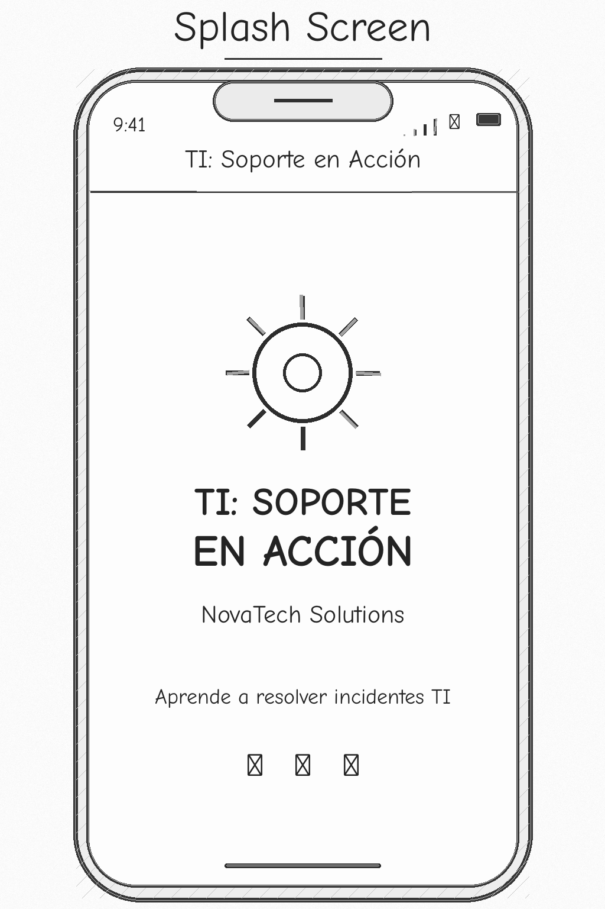

- **Descripción:** Presenta el proyecto y a Alex antes de comprobar la sesión.
- **Plataforma:** Flutter (Android/iOS).
- **Rol(es) autorizados:** Público.
- **Componentes principales:** Logotipo del videojuego, Ilustración de Alex, Nombre del producto.
- **Acciones posibles:** Iniciar automáticamente.
- **Pantallas relacionadas:** P02.
- **Requerimientos asociados:** RNF-04.
- **Historia de usuario:** HU-01.
- **Ruta conceptual:** `/splash`.
- **Archivo independiente:** [`P01_Splash_Screen.png`](../sketches/P01_Splash_Screen.png).

## P02 · Loading Screen

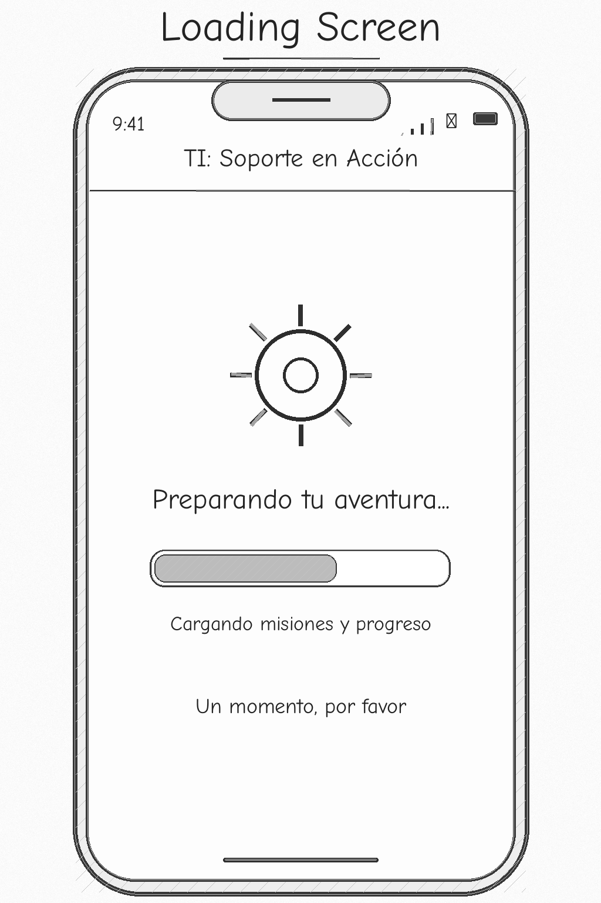

- **Descripción:** Muestra el progreso mientras se restauran configuración y sesión.
- **Plataforma:** Flutter (Android/iOS).
- **Rol(es) autorizados:** Público.
- **Componentes principales:** Logotipo, Barra de carga, Indicador de actividad.
- **Acciones posibles:** Esperar, Reintentar si falla la carga.
- **Pantallas relacionadas:** P03, P09.
- **Requerimientos asociados:** RNF-02, RF-02.
- **Historia de usuario:** HU-01.
- **Ruta conceptual:** `/cargando`.
- **Archivo independiente:** [`P02_Loading_Screen.png`](../sketches/P02_Loading_Screen.png).

## P03 · Iniciar sesión

- **Descripción:** Solicita credenciales y dirige al usuario autorizado a su inicio.
- **Plataforma:** Flutter (Android/iOS).
- **Rol(es) autorizados:** Público.
- **Componentes principales:** Correo, Contraseña, Mostrar/ocultar contraseña, Ingresar, Crear cuenta.
- **Acciones posibles:** Iniciar sesión, Crear cuenta, Recuperar acceso, Consultar acerca del sistema.
- **Pantallas relacionadas:** P04, P05, P07, P09, P10.
- **Requerimientos asociados:** RF-02, RF-03, RNF-01.
- **Historia de usuario:** HU-02.
- **Ruta conceptual:** `/acceso`.
- **Archivo independiente:** [`P03_Iniciar_Sesion.png`](../sketches/P03_Iniciar_Sesion.png).

## P04 · Recuperar cuenta

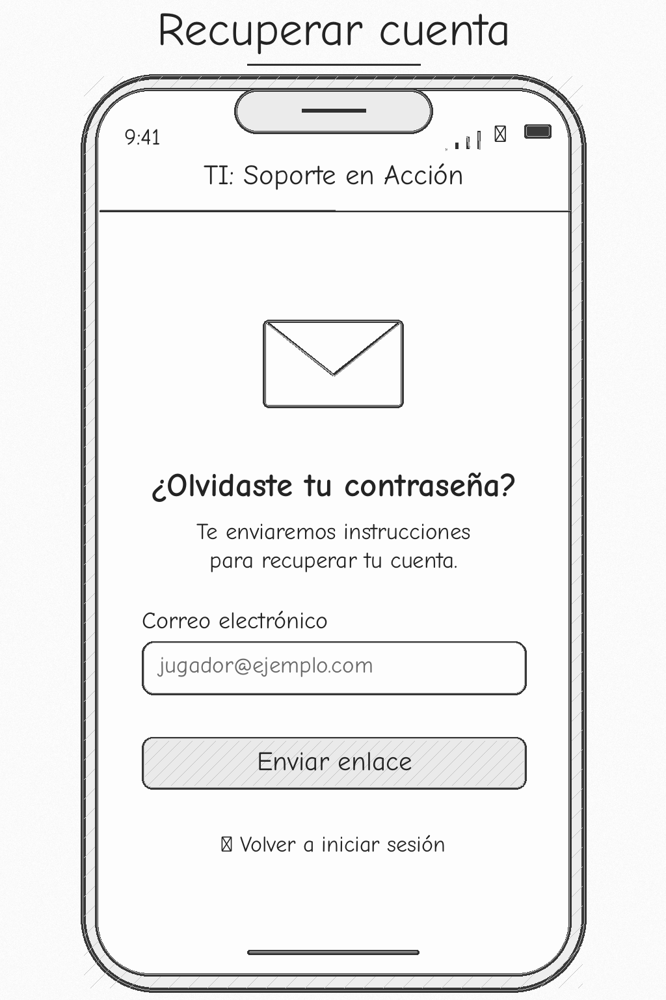

- **Descripción:** Inicia el proceso de recuperación por correo verificado.
- **Plataforma:** Flutter (Android/iOS).
- **Rol(es) autorizados:** Público.
- **Componentes principales:** Campo de correo, Botón de envío, Mensaje neutro de confirmación.
- **Acciones posibles:** Solicitar código, Volver al ingreso.
- **Pantallas relacionadas:** P03, P06.
- **Requerimientos asociados:** RF-04, RNF-01.
- **Historia de usuario:** HU-03.
- **Ruta conceptual:** `/recuperacion`.
- **Archivo independiente:** [`P04_Recuperar_Cuenta.png`](../sketches/P04_Recuperar_Cuenta.png).

## P05 · Cuenta bloqueada

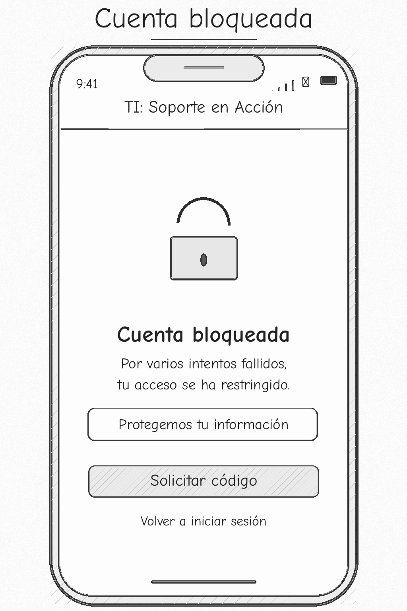

- **Descripción:** Informa que se suspendió temporalmente el inicio de sesión después de intentos fallidos.
- **Plataforma:** Flutter (Android/iOS).
- **Rol(es) autorizados:** Público.
- **Componentes principales:** Ícono candado, Explicación de bloqueo, Acción de desbloqueo.
- **Acciones posibles:** Solicitar desbloqueo, Volver.
- **Pantallas relacionadas:** P03, P06.
- **Requerimientos asociados:** RF-05, RNF-01.
- **Historia de usuario:** HU-04.
- **Ruta conceptual:** `/bloqueo`.
- **Archivo independiente:** [`P05_Cuenta_Bloqueada.png`](../sketches/P05_Cuenta_Bloqueada.png).

## P06 · Código de desbloqueo

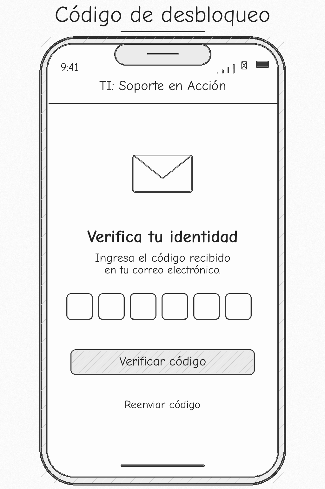

- **Descripción:** Valida un código de un solo uso enviado por un medio verificado.
- **Plataforma:** Flutter (Android/iOS).
- **Rol(es) autorizados:** Público.
- **Componentes principales:** Casillas de código, Confirmar, Reenviar con espera.
- **Acciones posibles:** Verificar código, Reenviar código, Regresar.
- **Pantallas relacionadas:** P03, P04, P05.
- **Requerimientos asociados:** RF-04, RF-05.
- **Historia de usuario:** HU-04.
- **Ruta conceptual:** `/verificar-codigo`.
- **Archivo independiente:** [`P06_Codigo_Desbloqueo.png`](../sketches/P06_Codigo_Desbloqueo.png).

## P07 · Acerca del software

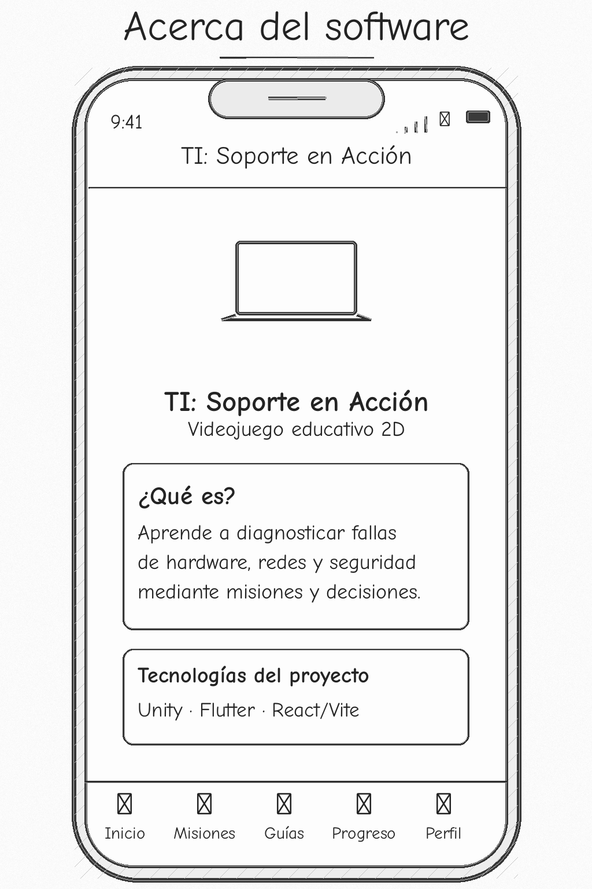

- **Descripción:** Explica el juego, sus objetivos educativos y plataformas de aprendizaje.
- **Plataforma:** Flutter (Android/iOS).
- **Rol(es) autorizados:** Público.
- **Componentes principales:** Logo, Descripción, Módulos, Créditos.
- **Acciones posibles:** Ver equipo, Volver.
- **Pantallas relacionadas:** P03, P08, P09.
- **Requerimientos asociados:** RF-06.
- **Historia de usuario:** HU-05.
- **Ruta conceptual:** `/acerca`.
- **Archivo independiente:** [`P07_Acerca_Del_Software.png`](../sketches/P07_Acerca_Del_Software.png).

## P08 · Acerca del equipo / empresa

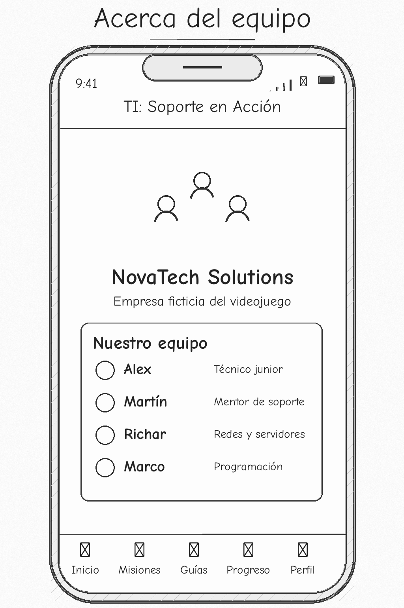

- **Descripción:** Presenta NovaTech Solutions, los integrantes y el contexto académico.
- **Plataforma:** Flutter (Android/iOS).
- **Rol(es) autorizados:** Público.
- **Componentes principales:** Nombre de empresa, Ilustración del equipo, Resumen, Volver.
- **Acciones posibles:** Regresar a acerca.
- **Pantallas relacionadas:** P07.
- **Requerimientos asociados:** RF-06.
- **Historia de usuario:** HU-05.
- **Ruta conceptual:** `/equipo`.
- **Archivo independiente:** [`P08_Acerca_Del_Equipo.png`](../sketches/P08_Acerca_Del_Equipo.png).

## P09 · Inicio (Home)

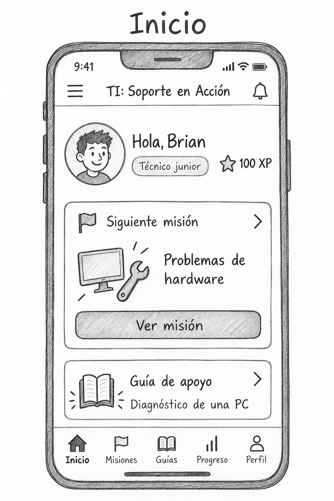

- **Descripción:** Es la entrada después de la autenticación: accesos acordes al rol, misión próxima o módulo de gestión.
- **Plataforma:** Flutter (Android/iOS).
- **Rol(es) autorizados:** Autenticado.
- **Componentes principales:** Bienvenida, Estado de sesión, Accesos rápidos por rol, Menú de navegación.
- **Acciones posibles:** Abrir módulo permitido, Abrir perfil, Cerrar sesión desde perfil.
- **Pantallas relacionadas:** P07, P11, P13, P15, P16, P17, P18, P19, P20.
- **Requerimientos asociados:** RF-07, RF-16, RNF-01.
- **Historia de usuario:** HU-06.
- **Ruta conceptual:** `/inicio`.
- **Archivo independiente:** [`P09_Inicio_Home.png`](../sketches/P09_Inicio_Home.png).

## P10 · Registro de cuenta

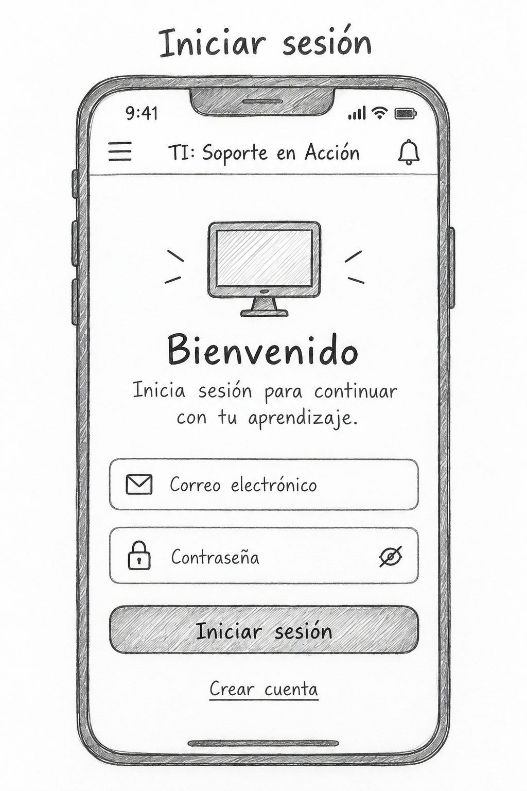

- **Descripción:** Permite solicitar una cuenta de estudiante y comprueba campos obligatorios y duplicados.
- **Plataforma:** Flutter (Android/iOS).
- **Rol(es) autorizados:** Público.
- **Componentes principales:** Nombre, Correo, Contraseña, Confirmación, Registrarme.
- **Acciones posibles:** Registrar, Corregir campos, Regresar a login.
- **Pantallas relacionadas:** P03.
- **Requerimientos asociados:** RF-01, RNF-01.
- **Historia de usuario:** HU-07.
- **Ruta conceptual:** `/registro`.
- **Archivo independiente:** [`P10_Registro.png`](../sketches/P10_Registro.png).

## P11 · Misiones

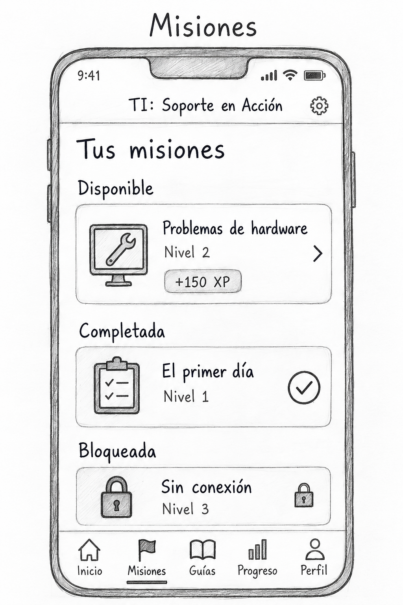

- **Descripción:** Lista misiones disponibles, completadas y bloqueadas y el XP potencial.
- **Plataforma:** Flutter (Android/iOS).
- **Rol(es) autorizados:** Estudiante/Jugador.
- **Componentes principales:** Tarjetas de misión, Estado, Nivel, XP, Barra inferior.
- **Acciones posibles:** Filtrar, Seleccionar misión, Volver a inicio.
- **Pantallas relacionadas:** P09, P12, P15.
- **Requerimientos asociados:** RF-08, RF-10.
- **Historia de usuario:** HU-08.
- **Ruta conceptual:** `/misiones`.
- **Archivo independiente:** [`P11_Misiones.png`](../sketches/P11_Misiones.png).

## P12 · Detalle de misión

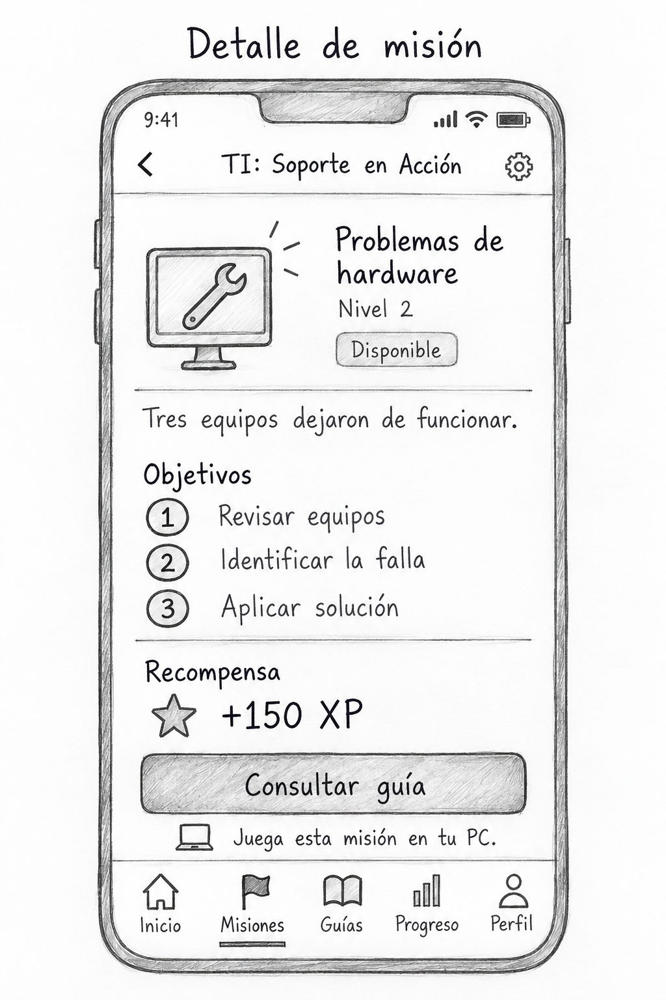

- **Descripción:** Expone objetivos, requisitos y recompensas; la ejecución 2D sucede en Unity en PC.
- **Plataforma:** Flutter (Android/iOS).
- **Rol(es) autorizados:** Estudiante/Jugador.
- **Componentes principales:** Título, Objetivos, Recompensa XP, Estado de misión, Acceso a guía.
- **Acciones posibles:** Consultar guía, Volver a misiones, Leer indicación de uso en PC.
- **Pantallas relacionadas:** P11, P13.
- **Requerimientos asociados:** RF-08, RF-09.
- **Historia de usuario:** HU-08.
- **Ruta conceptual:** `/misiones/detalle`.
- **Archivo independiente:** [`P12_Detalle_Mision.png`](../sketches/P12_Detalle_Mision.png).

## P13 · Guías de apoyo

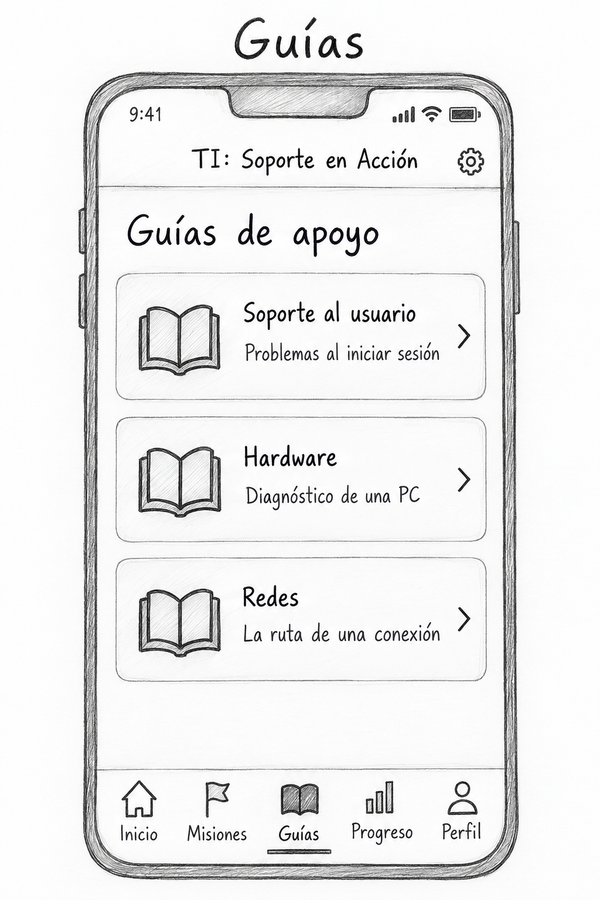

- **Descripción:** Organiza referencias educativas sobre soporte, hardware, redes y seguridad.
- **Plataforma:** Flutter (Android/iOS).
- **Rol(es) autorizados:** Estudiante/Jugador.
- **Componentes principales:** Categorías, Tarjetas de guías, Navegación inferior.
- **Acciones posibles:** Abrir guía, Volver al inicio.
- **Pantallas relacionadas:** P09, P12, P14.
- **Requerimientos asociados:** RF-11.
- **Historia de usuario:** HU-09.
- **Ruta conceptual:** `/guias`.
- **Archivo independiente:** [`P13_Guias.png`](../sketches/P13_Guias.png).

## P14 · Lectura de guía

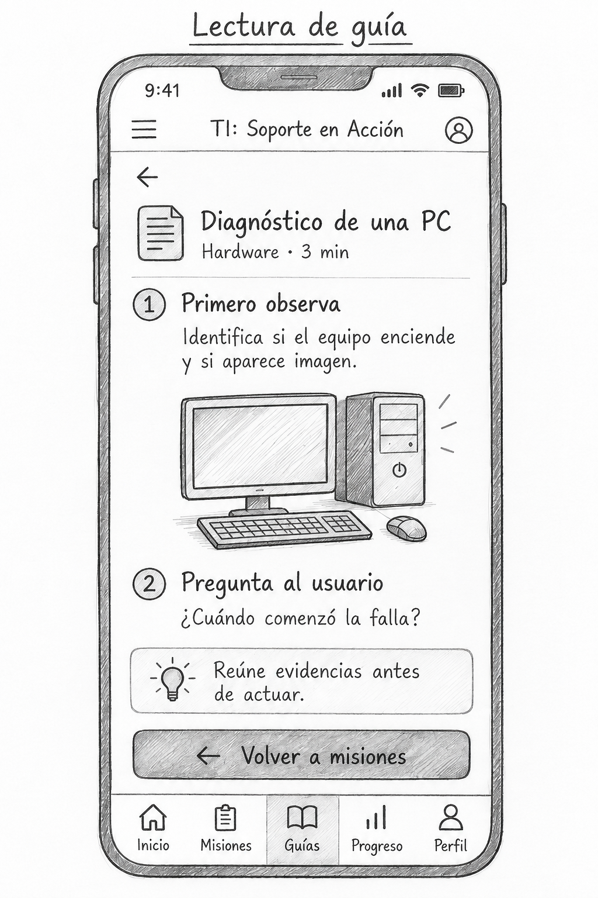

- **Descripción:** Muestra una guía concreta con pasos e ilustraciones a lápiz.
- **Plataforma:** Flutter (Android/iOS).
- **Rol(es) autorizados:** Estudiante/Jugador.
- **Componentes principales:** Título, Categoría, Pasos numerados, Imagen de apoyo.
- **Acciones posibles:** Leer, Regresar a guías, Volver a misión contextual.
- **Pantallas relacionadas:** P12, P13.
- **Requerimientos asociados:** RF-11.
- **Historia de usuario:** HU-09.
- **Ruta conceptual:** `/guias/lectura`.
- **Archivo independiente:** [`P14_Lectura_Guia.png`](../sketches/P14_Lectura_Guia.png).

## P15 · Mi progreso

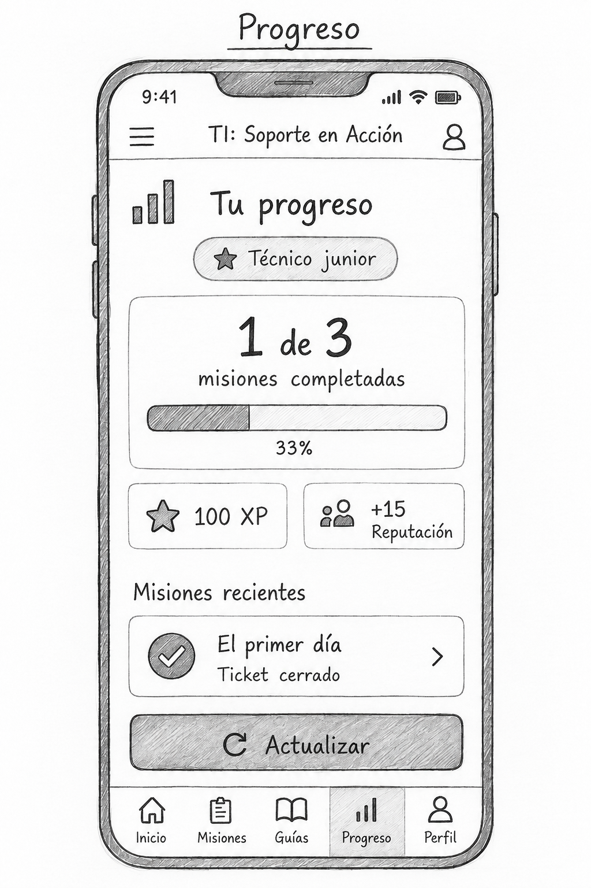

- **Descripción:** Consulta misiones completadas, experiencia y reputación, sincronizadas con el sistema.
- **Plataforma:** Flutter (Android/iOS).
- **Rol(es) autorizados:** Estudiante/Jugador.
- **Componentes principales:** Porcentaje, Barra de progreso, XP, Historial.
- **Acciones posibles:** Actualizar, Abrir misiones, Volver a inicio.
- **Pantallas relacionadas:** P09, P11, P16.
- **Requerimientos asociados:** RF-10, RF-12.
- **Historia de usuario:** HU-10.
- **Ruta conceptual:** `/progreso`.
- **Archivo independiente:** [`P15_Progreso.png`](../sketches/P15_Progreso.png).

## P16 · Mi perfil

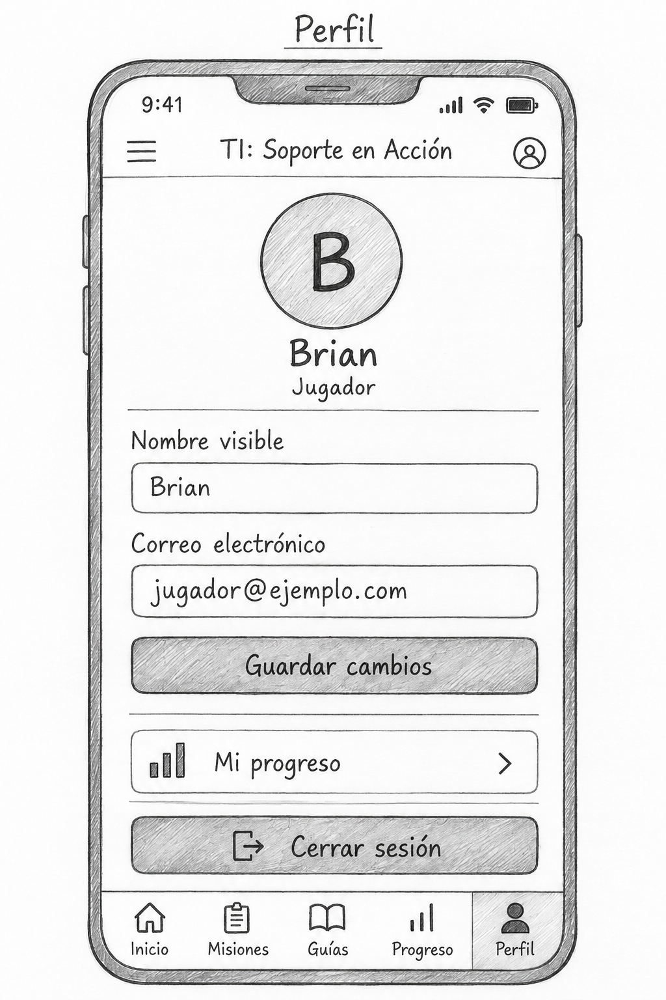

- **Descripción:** Permite consultar/editar datos básicos y finalizar sesión.
- **Plataforma:** Flutter (Android/iOS).
- **Rol(es) autorizados:** Autenticado.
- **Componentes principales:** Avatar, Nombre visible, Correo, Guardar cambios, Cerrar sesión.
- **Acciones posibles:** Editar nombre, Guardar, Ver progreso solo estudiante, Cerrar sesión.
- **Pantallas relacionadas:** P03, P09, P15.
- **Requerimientos asociados:** RF-13, RF-02.
- **Historia de usuario:** HU-11.
- **Ruta conceptual:** `/perfil`.
- **Archivo independiente:** [`P16_Perfil.png`](../sketches/P16_Perfil.png).

## P17 · Panel docente

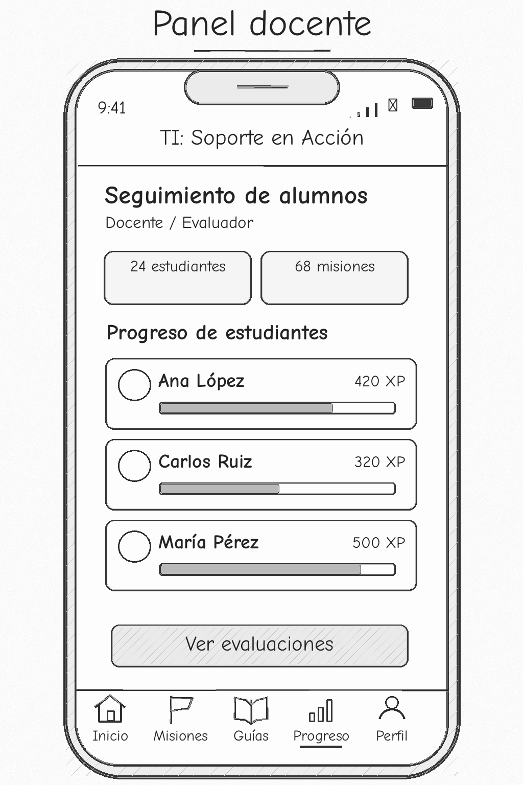

- **Descripción:** Consulta progreso académico agregado del grupo y evaluaciones de estudiantes asignados.
- **Plataforma:** Flutter (Android/iOS).
- **Rol(es) autorizados:** Docente/Evaluador.
- **Componentes principales:** Resumen de estudiantes, Barras de avance, Estado de misiones.
- **Acciones posibles:** Consultar seguimiento, Regresar al inicio.
- **Pantallas relacionadas:** P09.
- **Requerimientos asociados:** RF-14, RF-16.
- **Historia de usuario:** HU-12.
- **Ruta conceptual:** `/docente`.
- **Archivo independiente:** [`P17_Panel_Docente.png`](../sketches/P17_Panel_Docente.png).

## P18 · Gestión de usuarios

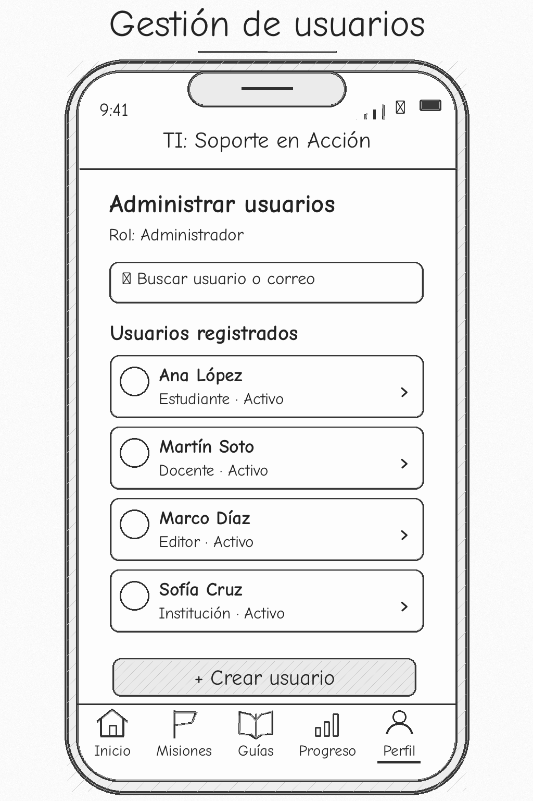

- **Descripción:** Visualiza, filtra y administra cuentas autorizadas sin revelar contraseñas.
- **Plataforma:** Flutter (Android/iOS).
- **Rol(es) autorizados:** Administrador.
- **Componentes principales:** Buscador, Listado, Rol, Estado, Acción de alta.
- **Acciones posibles:** Consultar, Cambiar rol si autorizado, Activar o suspender, Regresar.
- **Pantallas relacionadas:** P09.
- **Requerimientos asociados:** RF-15, RF-16.
- **Historia de usuario:** HU-13.
- **Ruta conceptual:** `/admin/usuarios`.
- **Archivo independiente:** [`P18_Gestion_Usuarios.png`](../sketches/P18_Gestion_Usuarios.png).

## P19 · Editor de misiones

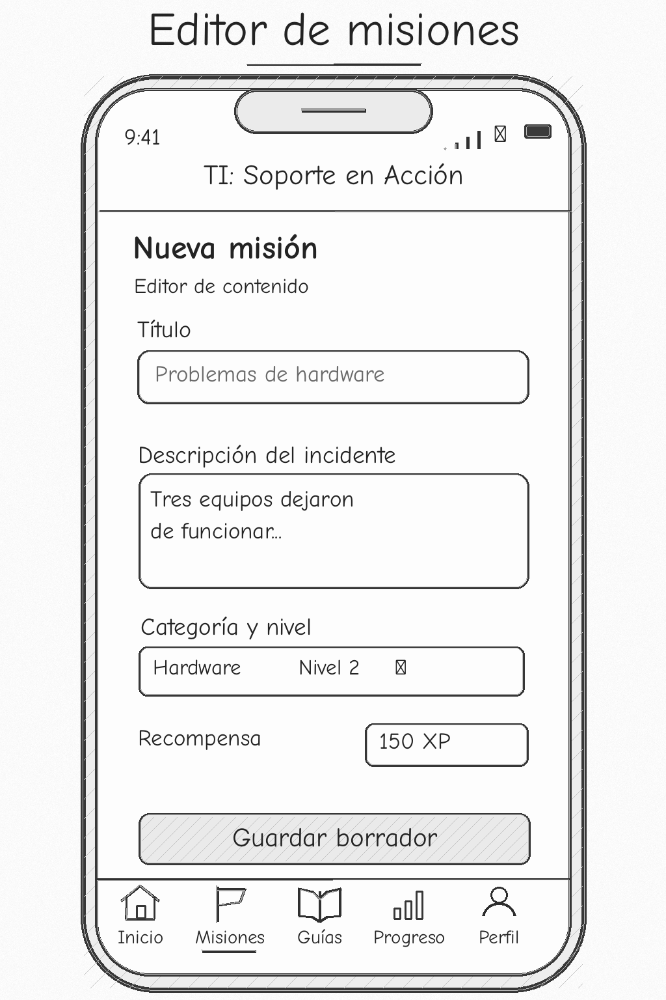

- **Descripción:** Permite proponer o editar título, objetivos y recompensa de misiones educativas.
- **Plataforma:** Flutter (Android/iOS).
- **Rol(es) autorizados:** Editor de contenido.
- **Componentes principales:** Campos de misión, Categoría, Nivel, Recompensa, Guardar.
- **Acciones posibles:** Editar borrador, Guardar, Volver.
- **Pantallas relacionadas:** P09.
- **Requerimientos asociados:** RF-17, RF-16.
- **Historia de usuario:** HU-14.
- **Ruta conceptual:** `/editor/misiones`.
- **Archivo independiente:** [`P19_Editor_Misiones.png`](../sketches/P19_Editor_Misiones.png).

## P20 · Reportes institucionales

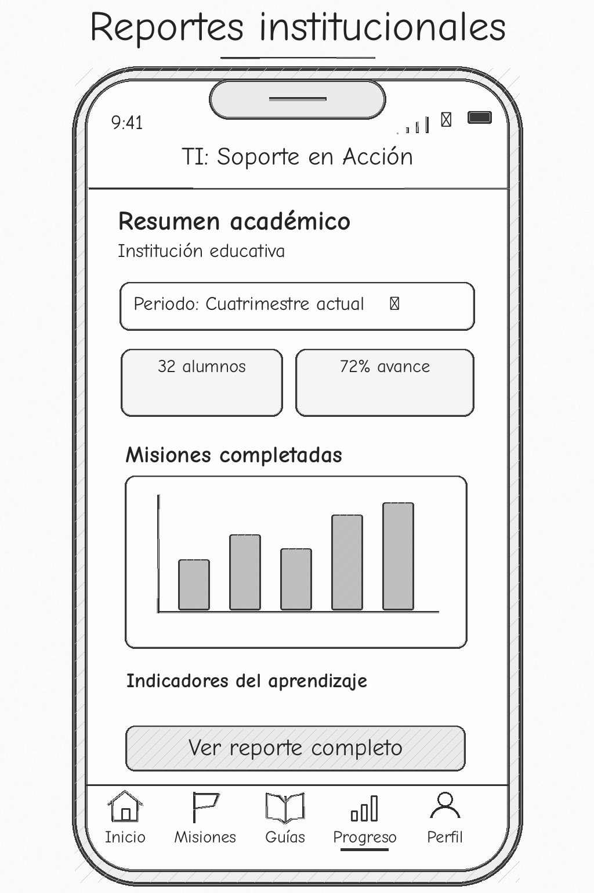

- **Descripción:** Presenta indicadores agregados y reportes académicos según el ámbito autorizado.
- **Plataforma:** Flutter (Android/iOS).
- **Rol(es) autorizados:** Institución educativa.
- **Componentes principales:** Selector de periodo, Tarjetas KPI, Gráfica de barras, Acceso a reporte.
- **Acciones posibles:** Filtrar, Consultar resumen, Regresar.
- **Pantallas relacionadas:** P09.
- **Requerimientos asociados:** RF-18, RF-16.
- **Historia de usuario:** HU-15.
- **Ruta conceptual:** `/institucion/reportes`.
- **Archivo independiente:** [`P20_Reportes_Institucion.png`](../sketches/P20_Reportes_Institucion.png).
